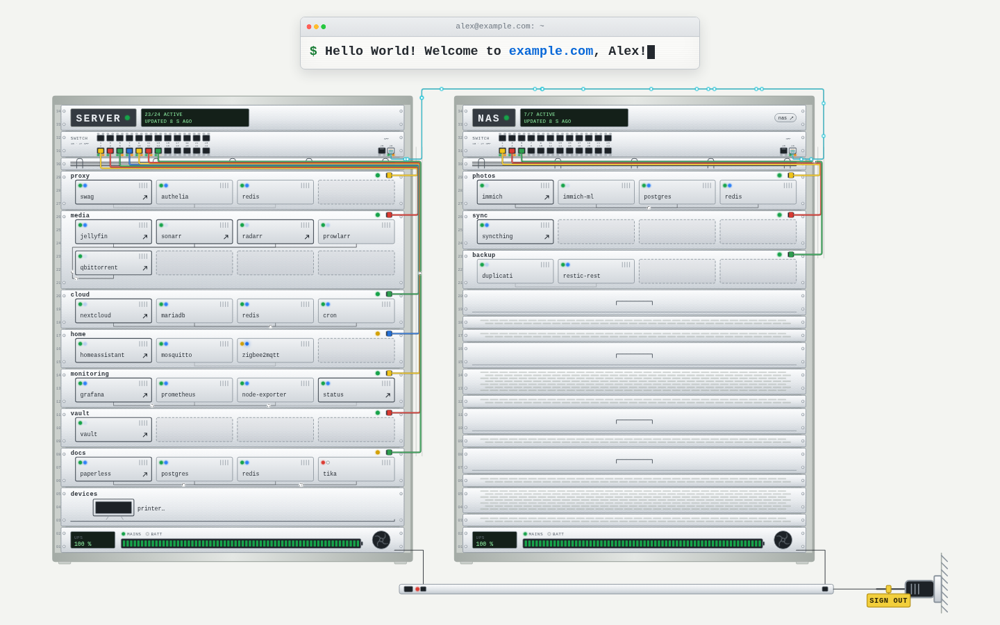
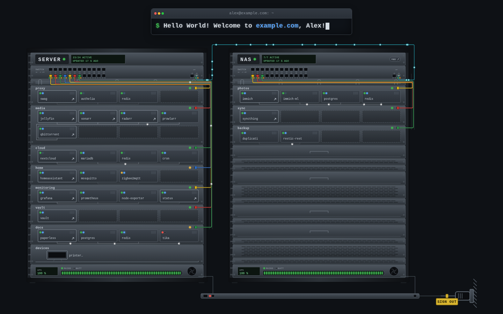
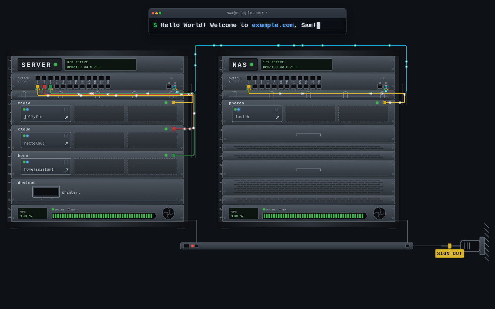
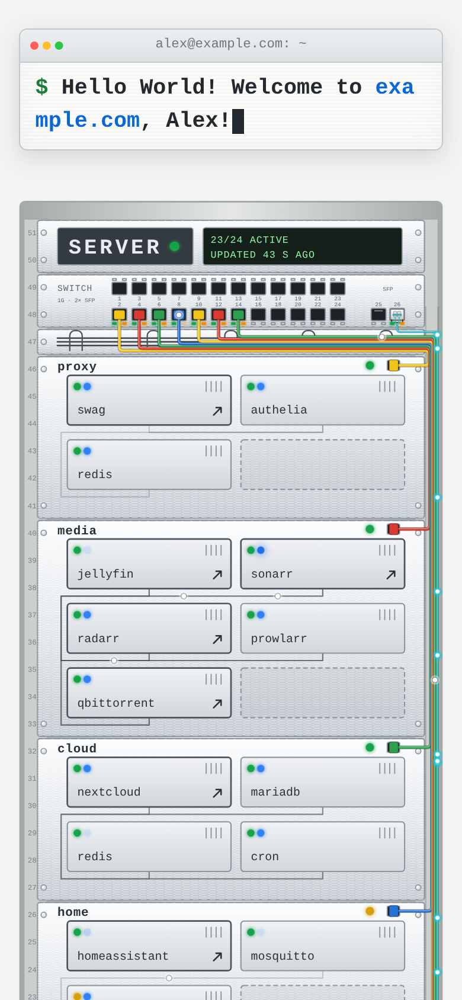
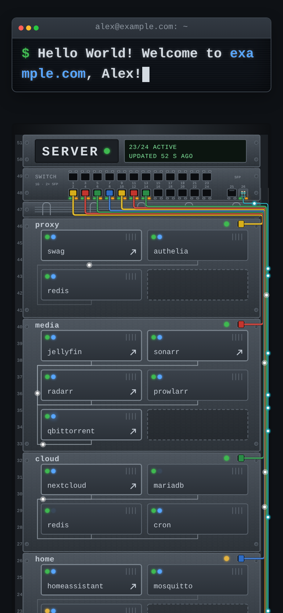
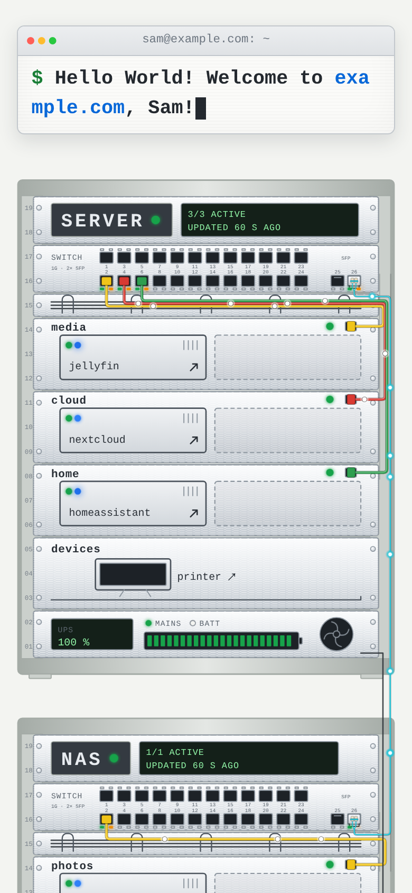
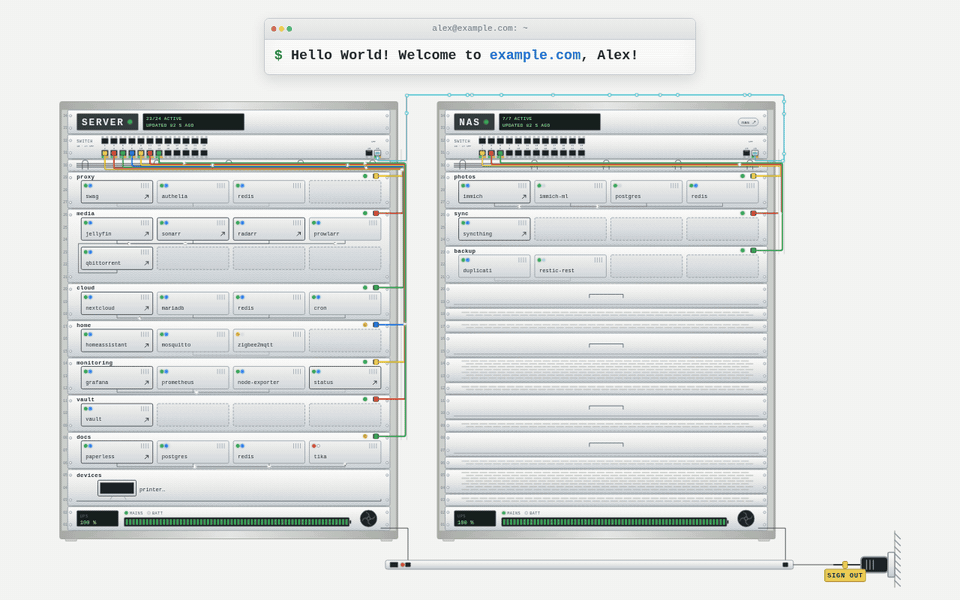
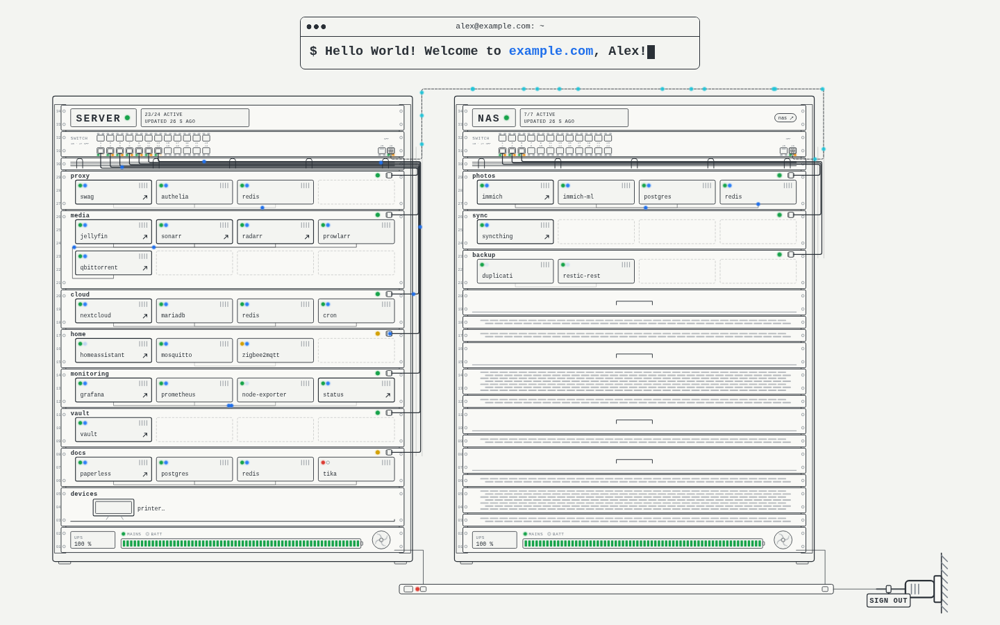
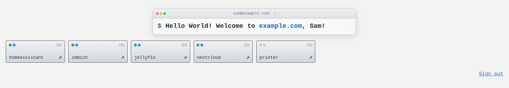

# Server Room

A start page for self-hosted services behind [SWAG](https://github.com/linuxserver/docker-swag) and [Authelia](https://www.authelia.com/). It shows every signed-in user exactly the services Authelia lets them open, drawn as a server rack: one rack per Docker host, one chassis per compose stack, one module per container. New proxy confs and changes to your stacks show up by themselves; access rights are maintained in Authelia only.


## Screenshots

All screenshots show a made-up installation at `example.com`: a server and a NAS with a few typical self-hosted stacks.

### Light and dark

The page follows the system's colour scheme. Green LEDs mean running, yellow unhealthy, red stopped; modules with an arrow link to their service.

| Light | Dark |
|---|---|
|  |  |

### Admins and everyone else

Admins see every stack and container, also those without a domain, such as databases. Everyone else only gets the containers of the services Authelia lets them open. The rest of each chassis stays blank and gives away nothing, and the filter runs on the server.

| Admin | Regular user |
|---|---|
|  |  |

### Phones

On narrow screens the racks are stacked.

| Admin, light | Admin, dark | Regular user |
|---|---|---|
|  |  |  |

### Signing out

Pull the plug to sign out: the UPS units count down on battery, then power everything down before the page goes to Authelia's logout. Plugging back in before the battery is empty cancels it.



### More contrast and no JavaScript

With "more contrast" the rack is drawn as plain outlines. Without JavaScript the services are shown as a list of tiles.





## Features

- Status LEDs per container (green running, yellow unhealthy, created or paused, red stopped), filler units for shorter racks and animated pseudo traffic between containers that share a Docker network.
- Updates every 15 s without reloading.
- Admins see every stack and container; everyone else only the containers of their own services. The filter runs on the server.
- Sign out by pulling the power plug of the rack, with a little shutdown animation (see below).
- Greets the user by first name, typed like on a typewriter in a terminal window.
- Patch cables to a switch and a fibre link between the racks, with light pulses running both ways.
- Works without JavaScript as a list of tiles.
- Follows light and dark mode, "more contrast" and "reduce motion".

## Requirements

- [SWAG](https://github.com/linuxserver/docker-swag) by linuxserver.io, which serves the page with its bundled PHP-FPM (PHP 8 with the curl extension).
- Services published through SWAG subdomain proxy confs (`/config/nginx/proxy-confs/<name>.subdomain.conf` with `server_name <name>.*;`, `$upstream_app` and `$upstream_port`).
- Authelia 4.38 or newer, reachable from SWAG as `http://authelia:9091` (configurable), and SWAG's `authelia-server.conf` and `authelia-location.conf` in use. A service counts as protected when its proxy conf includes `authelia-location.conf`.
- A JSON snapshot of your compose stacks in `data/stacks.json`, refreshed by a job of your own (see [Stack snapshot](#stack-snapshot)).
- A current browser. JavaScript is optional.

## Installation

1. Put this folder at `/config/www/start` inside the SWAG config, next to (not inside) your site's web root. Nothing here is meant to be reachable by URL; nginx runs `index.php` directly.

   ```sh
   git clone <this repository> <swag-config>/www/start
   ```
2. Create the configuration and set at least `BASE_DOMAIN`:

   ```sh
   cp .env.example .env
   ```
3. Add the page to the server block of your main domain, e.g. `/config/nginx/site-confs/example.com.conf`:

   ```nginx
   include /config/nginx/authelia-server.conf;

   location = / {
       limit_except GET {
           deny all;
       }
       include /config/nginx/authelia-location.conf;
       fastcgi_hide_header X-Powered-By;
       include /etc/nginx/fastcgi_params;
       fastcgi_param SCRIPT_FILENAME /config/www/start/index.php;
       fastcgi_param REMOTE_USER $user;
       fastcgi_param REMOTE_NAME $name;
       fastcgi_param REMOTE_GROUPS $groups;
       fastcgi_pass 127.0.0.1:9000;
   }
   ```

   `$user`, `$name` and `$groups` are set by `authelia-location.conf`. `/?data=1` goes through the same location.
4. Let every signed-in user open the page in Authelia's `configuration.yml`:

   ```yaml
   access_control:
     rules:
       - domain: example.com
         policy: one_factor
   ```
5. Set up a job that writes `data/stacks.json` (see [Stack snapshot](#stack-snapshot)).
6. Reload nginx: `docker exec swag nginx -s reload`.

## Configuration

All settings live in `.env` next to `index.php`; `.env.example` documents them. Environment variables of the same name take precedence, e.g. in a container; `ENV_FILE` points to another file instead of `.env`. Lists are comma-separated, maps are comma-separated `name=value` pairs, and service names are proxy conf file names without `.subdomain.conf`.

| Key | Default | Meaning |
|---|---|---|
| `BASE_DOMAIN` | `example.com` | Domain whose subdomains SWAG serves (required) |
| `AUTHELIA_URL` | `http://authelia:9091` | Authelia as reached from the SWAG container |
| `LOGOUT_URL` | `https://auth.<BASE_DOMAIN>/logout` | Where signing out leads |
| `PROXY_CONFS` | `/config/nginx/proxy-confs/*.subdomain.conf` | Proxy confs to read |
| `SKIPPED_SERVICES` | `auth` | Services that are never shown |
| `ADMIN_GROUP` | `admins` | Group that sees all stacks and containers |
| `GROUPS_WITHOUT_AUTHELIA` | `admins` | Groups that see services without Authelia |
| `GROUPS_WITHOUT_AUTHELIA_PER_SERVICE` |  | The same per service, e.g. `jellyfin=admins\|family` |
| `SERVICE_CONTAINERS` |  | Container for services whose proxy conf has no usable upstream, e.g. `dashboard=swag` |
| `SERVICE_PATHS` |  | Start path for services whose UI does not live at `/`, e.g. `pihole=/admin/` |
| `SNAPSHOT_FILE` | `data/stacks.json` next to `index.php` | Stack snapshot (see [Stack snapshot](#stack-snapshot)) |
| `SNAPSHOT_MAX_AGE` | `180` | Seconds after which the stack snapshot counts as stale |

Timings of the animation are constants at the top of `rack.js` (`SHUTDOWN_MS`, `PHASES`, `LOW_BATTERY`, `FIBER_GAP_MS`).

## Stack snapshot

The page never talks to Docker itself. A job of yours writes `data/stacks.json`, for example every 30 s from cron on the Docker host. This keeps any Docker or API credentials out of the internet-facing SWAG container. Write the file atomically (temp file plus rename).

```json
{
  "generated": 1767225600,
  "environments": [
    {
      "id": 1,
      "name": "server",
      "ip": "192.0.2.10",
      "online": true,
      "stacks": [
        {
          "name": "media",
          "containers": [
            {
              "name": "media-jellyfin-1",
              "service": "jellyfin",
              "state": "running",
              "health": "healthy",
              "ports": [8096],
              "networks": ["proxy"]
            }
          ]
        }
      ]
    }
  ]
}
```

- `generated`: Unix time of the snapshot. Older than `SNAPSHOT_MAX_AGE` means stale, which the page shows.
- One environment per Docker host. `ip` is the address proxy confs use for it, `online: false` marks a host that could not be read (keep its last stacks).
- `state` and `health` as reported by Docker, `ports` the published host ports, `networks` the Docker network names.
- The format follows what Dockhand returns from `GET /api/environments` and `GET /api/stacks?env=<id>`, but any source works, e.g. `docker ps` and `docker inspect` per host.

## How it works

### Who sees what

1. For every service whose proxy conf includes `authelia-location.conf`, `index.php` asks Authelia's `/api/authz/auth-request` with `X-Original-URL` and the user's `authelia_session` cookie, all hosts in parallel. `200` shows the service, `401` too (only a second factor is missing), anything else hides it.
2. Services without Authelia are shown to the groups in `GROUPS_WITHOUT_AUTHELIA` (or `GROUPS_WITHOUT_AUTHELIA_PER_SERVICE`).
3. Members of `ADMIN_GROUP` see all stacks and containers, also those without a domain. Everyone else only sees the containers of their own services; the rest of a chassis is blank and gives away no count. The same filter applies to `/?data=1`.

### From service to container

The first matching rule wins:

1. An entry in `SERVICE_CONTAINERS`.
2. `$upstream_app` is a name: the container with that compose service or container name.
3. `$upstream_app` is an IP: the environment with that `ip`, then the container publishing `$upstream_port`, else the compose service named like the proxy conf (host network, stopped containers). Without a match the service becomes a button in the rack head.
4. The compose service named like the proxy conf; without a match the service goes into a "devices" bay.

### The rack

- Each rack has a head unit with a name plate, a status LED and the number of active modules; a small display next to it shows the age of the data and status messages.
- The racks are centred and sized to the window, from 75 % of the width up to 1500 px; they stack on narrow screens.
- A 2U switch with numbered ports sits on top. Every chassis is plugged into it with a patch cable coloured by slot; stacks without containers in the `proxy` network carry less traffic.
- Faceplates are brushed aluminium, the rack is light grey steel (anthracite in dark mode); colours are CSS variables (`--metal-*`, `--steel-*`) in `style.css`.
- Service links open in a new tab.

### Signing out

All UPS units hang on a power strip whose plug sits in a wall socket. Clicking the plug pulls it. A countdown "Shutting down 10... 9... … 0" is typed in real seconds while the UPS units run on battery. At 0 the battery is down to 20 % and the UPS powers everything down: traffic stops, LEDs go out and fans coast down while the battery drains to 0 %. The rack stays dark for 2 s, then the page fades out and goes to Authelia's logout.

Plugging back in before the battery is empty cancels the shutdown: the rack boots again, the batteries recharge and the greeting is typed anew.

Without JavaScript or with "reduce motion" the plug is a plain link to the logout. Without JavaScript a sign-out link sits below the tiles.

## Development

- No build step and no dependencies. Changes are live on the next request; nginx only needs a reload when its conf changes.
- Syntax check: `docker exec swag php -l /config/www/start/index.php`
- `/?dry` plays the sign-out animation and reloads the page instead of signing out.
- `docs/screenshots/capture/capture.sh` regenerates the screenshots and GIFs from a made-up installation, using only Docker (see [AGENTS.md](AGENTS.md#screenshots)).

Show the mapping without a browser, as an admin:

```sh
docker exec swag php -r '$_SERVER["REMOTE_GROUPS"]="admins";
  ob_start(); include "/config/www/start/index.php"; ob_end_clean();
  foreach (build_model($services, load_snapshot(), true)["racks"] as $r)
    foreach ($r["stacks"] as $s) echo $r["name"], "/", $s["name"], ": ", implode(", ", array_column($s["modules"], "label")), PHP_EOL;'
```

### Files

| File | Purpose |
|---|---|
| `index.php` | Logic: read proxy confs, ask Authelia, map services to containers, build the model, JSON endpoint |
| `.env.example` | Template for `.env`, the installation-specific settings (`.env` itself is not in Git) |
| `page.html.php` | HTML template; inlines CSS, JS and the initial model, `<noscript>` fallback |
| `style.css` | Styles and animations, inlined into the page |
| `favicon.svg` | Favicon, inlined as a data URI (there is deliberately no `favicon.ico`) |
| `intro.js` | Types the greeting into the terminal window and the shutdown countdown |
| `rack.js` | Draws the rack as SVG, polls `/?data=1`, animates traffic and the power plug |
| `data/stacks.json` | Stack snapshot, written by your own job, not in Git |
| `docs/screenshots/` | Screenshots and GIFs for the README, taken with made-up sample data |
| `docs/screenshots/capture/` | Regenerates them: `capture.sh`, the capture script, its Docker image and the sample installation in `sample/` |

See [CHANGELOG.md](CHANGELOG.md) for the history and [AGENTS.md](AGENTS.md) for contribution guidelines.

## License

[MIT](LICENSE)
